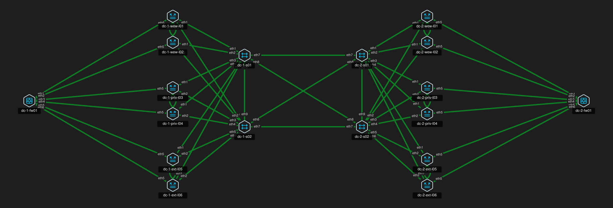

# AVD EVPN dual DC + DCI

Lab dwóch ośrodków (DC1, DC2) z bramami **EVPN multi-domain** na spine'ach, trzema strefami bezpieczeństwa
(`wew`, `priv`, `ext`) i geo-rozciągniętym klastrem firewall. Konfiguracja jest generowana przez
**Arista AVD 6.4**, wdrażana przez **CloudVision as-a-Service** (albo eAPI) i testowana przez **ANTA** oraz
własne testy ruchu. Lab działa w **containerlab** (18 × cEOS 4.35.6M).



`FW1 | pary leafów DC1 | bramy DC1 | bramy DC2 | pary leafów DC2 | FW2` – w każdej parze leaf `l01/l03/l05`
nad swoim partnerem MLAG, bramy połączone łączem `Et9`, DCI to pełna siatka `Et7/Et8` między bramami.
Diagram generuje `dual_dc/tools/gen_clab_svg.py` z pozycji zapisanych przez TopoViewer
(`dual_dc/clab/topology.clab.yml.annotations.json`).

## Architektura

| Element | Realizacja |
|---|---|
| Underlay | eBGP IPv4 po /31 (MTU 9214); ogłaszane tylko loopbacki (Lo0, VTEP Lo1) |
| Overlay | eBGP EVPN multihop Lo0↔Lo0; spine'y to route servery (`next-hop-unchanged`), nie Route Reflectory |
| ASN | DC1: bramy 65100, pary leafów 65101 (wew) / 65102 (priv) / 65103 (ext); DC2: 65200, 65201–65203 |
| Bramy EVPN | spine'y = VTEP + brama multi-domain (`domain remote`, D-PATH 65100:1 / 65200:2), all-active I-ESI |
| **iBGP między bramami DC** | łącze `Et9` (iBGP IPv4) + iBGP EVPN Lo0↔Lo0 w peer groupie `EVPN-LOCAL-GW` – obie bramy widzą swoje trasy type-1/4 i wybierają **tego samego DF** (bez tego dwa DF-y = duplikaty BUM przez DCI) |
| **RT Constraint** | `address-family rt-membership` na sesjach EVPN – para leafów dostaje **tylko trasy swojej strefy**; bramy ogłaszają `default-route-target only` (obsługują wszystkie strefy) |
| **Łącze bram tylko jako zapas** | AS-path prepend dla loopbacków drugiej bramy (`PL-GW-PEER-LOOPBACKS`) w stronę leafów i przez DCI – ruch idzie bezpośrednio, `Et9` przejmuje go tylko przy awarii |
| DCI | 4 × /31 bramy↔bramy; `PL-DCI-IN/OUT` przepuszczają tylko loopbacki bram; przez DCI tylko VLAN-y z tagiem `dci` (110, 210, 310, 399) |
| Segmentacja | VRF per strefa: EXT (L3VNI 1009000, RT 10:10), WEW (2009000, 20:20), PRIV (3009000, 30:30); brak route leakingu i default route |
| BFD multihop | 1000 ms × 3 (wartość dla labu na współdzielonym hoście; na sprzęcie – domyślne 300 ms × 3) |
| Firewall | węzły `marpla-dc-{1,2}-fw01` (cEOS jako host, poza AVD), LACP do każdej pary leafów, SVI `.11` / `.12` w każdej strefie |

Szczegóły (VLAN-y, VNI, adresacja, okablowanie, pliki AVD): [dual_dc/README.md](dual_dc/README.md).

## Polecenia (`cd dual_dc && make <cel>`)

| Cel | Co robi |
|---|---|
| `start` | uruchamia lab (containerlab) |
| `stop` | niszczy lab |
| `inspect` | stan kontenerów labu |
| `build` | generuje configi AVD dla DC1 i DC2 oraz katalog testów DCI |
| `deploy` | wdraża configi przez eAPI |
| `deploy_cvp` | wdraża configi przez CloudVision – workspace, build i change control zatwierdzany i uruchamiany automatycznie |
| `diff` | różnice między running-config a configiem z AVD |
| `fw_test` | test płaszczyzny danych z obu węzłów FW: anycast GW, VLAN-y rozciągnięte, VLAN HA przez DCI |
| `test` | `fw_test` (generuje ruch potrzebny do tras type-2) + ANTA: katalogi AVD i testy BGP/EVPN/DCI |
| `test_dci` | `fw_test` + tylko testy BGP/EVPN/DCI/RTC (`avd/anta_catalogs/dci_tests.yml`) |
| `check_df` | tylko odczyt: obie bramy DC wybierają tego samego DF I-ESI dla każdego rozciągniętego VLAN-u (`LABEL=x` zapisuje szczegóły) |
| `dup_test` | duplikaty BUM przez DCI po wyczyszczeniu tablic MAC (`ROUNDS=3`); **czyści tablice MAC** |
| `soak` | ruch + ciągłe czyszczenie MAC przez `MIN` minut (domyślnie 10), potem flapy BFD na każdym urządzeniu; **czyści tablice MAC** |
| `help` | lista celów |

## Demo krok po kroku

Wymagania: containerlab, obraz `arista/ceos:4.35.6M` (`./get_ceos.sh -v 4.35.6M`, wymaga `ARISTA_TOKEN`),
Python z `pyavd`/AVD 6.4 i ANTA, tokeny CVaaS w `clab/cv-onboarding-token` i `clab/cv-api-token`.

```bash
cd dual_dc

# 1. lab - 18 kontenerów; urządzenia startują z init-config (mgmt + TerminAttr do CVaaS)
make start
make inspect

# 2. konfiguracja z AVD
make build
make deploy            # po każdym starcie labu - patrz uwagi niżej

# 3. stan sieci
make test_dci          # fw_test 20/20 + ANTA BGP/EVPN/DCI/RTC
make check_df          # DF zgodny na obu bramach w obu DC

# 4. ruch i stabilność
make dup_test ROUNDS=10
make soak MIN=10

# 5. zmiana przez CloudVision (np. po edycji group_vars i make build)
make deploy_cvp        # change control powstaje i wykonuje się sam

# 6. pełna walidacja i sprzątanie
make test              # ANTA: katalogi AVD + DCI
make stop
```

Co pokazać po drodze:

- **RT Constraint** – na leafie `show bgp rt-membership summary` i `show bgp evpn summary`: leaf strefy `wew`
  ma 17 tras EVPN zamiast 78 bez RTC (52 z nich to trasy obcych stref).
- **DF bram** – `show bgp evpn instance vlan 110` na `marpla-dc-1-s01` i `s02`: ten sam
  `Designated forwarder` (VLAN-y parzyste → `.1`, VLAN 399 → `.2`).
- **Łącze bram jako zapas** – na leafie `show ip route 10.101.3.1`: jedna ścieżka bezpośrednia;
  `show ip bgp 10.101.3.1/32`: ścieżka przez drugą bramę z AS-path `65100 65100`.
- **Brama multi-domain** – `show bgp evpn route-type mac-ip 10.3.10.12` na leafie DC1: MAC/IP FW2 widoczny
  za bramami DC1, a nie za VTEP-em leafa DC2.

## Wyniki

| Test | Wynik |
|---|---|
| `fw_test` | 20/20 celów osiągalnych |
| ANTA DCI (`make test_dci`) | 116/116 |
| ANTA pełna (`make test`) | 468/512 – 44 znane odstępstwa cEOS: `VerifyLoggingErrors` (identyfikacja sprzętu przy starcie), `VerifyInterfaceDiscards` (Management1 w sieci Dockera), `VerifyVxlanConfigSanity` (pusta flood list VLAN-ów lokalnych) |
| `check_df` | DF zgodny na obu bramach w obu DC |
| `soak` 30 min (host bez obciążenia) | 0 flapów BFD, 0 strat |
| ruch w stanie ustalonym | 0 duplikatów |
| `dup_test` | 30–45% serii z **+1** duplikatem przy pierwszym pakiecie po wyczyszczeniu MAC – wyścig zalewu unknown unicast z nauką MAC przez EVPN (brama znająca już MAC przekazuje zalaną kopię jako znany unicast), artefakt testu |
| ruch VXLAN przez `Et9` | 0 (przed prependem ~25%) |

## Uwagi

- **Po `make start` użyj `make deploy` (eAPI).** containerlab nadpisuje flash plikami init-config, a
  `deploy_cvp` nie wykryje zmiany – configlety w CVaaS się nie zmieniły, więc build kończy się `SKIPPED`
  i change control nie powstaje. `deploy_cvp` służy do wdrażania zmian z AVD.
- **Obciążenie hosta psuje testy ruchu.** BFD 1 s × 3 wykrywa przestoje hosta dłuższe niż 3 s. Podgląd
  topologii w rozszerzeniu Containerlab dla VS Code uruchamia `containerlab events --interface-stats`
  z interwałem 1 s, który potrafi zająć ponad 10 rdzeni – na czas `dup_test`/`soak` zamknij widok topologii
  albo wyłącz statystyki interfejsów.
- **cEOS nie wykrywa łączy dodanych w locie** (`containerlab tools veth create`) – nowe łącza wymagają
  ponownego `make start`.
- `dup_test` i `soak` czyszczą tablice MAC (zmiana stanu, odbudowa w kilka sekund). Pozostałe testy są tylko
  do odczytu.

## Struktura

| Ścieżka | Zawartość |
|---|---|
| `dual_dc/avd/` | inventory, `group_vars`, playbooki, wygenerowane configi i dokumentacja AVD, katalogi ANTA |
| `dual_dc/clab/` | topologia containerlab, init-configi, numery seryjne, układ TopoViewera |
| `dual_dc/tests/` | `check_df.sh`, `dup_test.sh`, `soak.sh` |
| `dual_dc/fw_test.sh` | test płaszczyzny danych z węzłów FW |
| `dual_dc/docs/`, `dual_dc/tools/` | diagramy i ich generatory |
| `avd_inventory/`, `clab/` | wcześniejszy lab jednego DC (L2LS, EVPN MLAG) – punkt wyjścia projektu |
