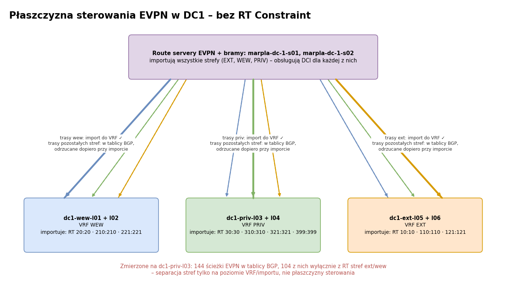
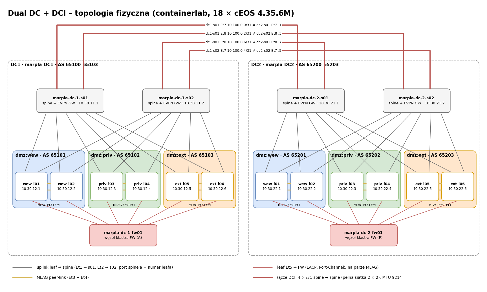
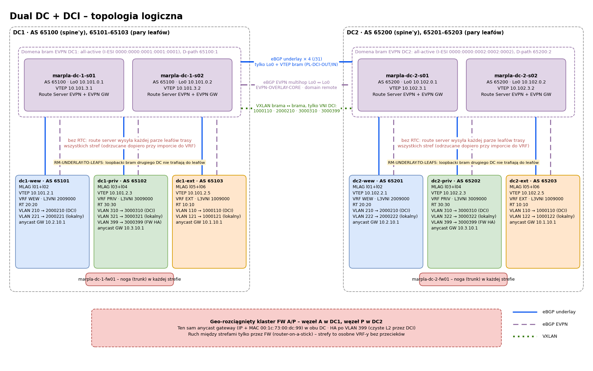

# Dual DC + DCI – EVPN multi-domain gateway z RT Constraint i iBGP między bramami

> **Gałąź `single-domain-rtc-gw-ibgp`** – dwa ośrodki ze wspólnymi bramami EVPN dla wszystkich stref
> bezpieczeństwa, **BGP Route Target Constraint (RFC 4684)** (leaf dostaje w płaszczyźnie sterowania
> wyłącznie trasy EVPN swojej strefy) **oraz łącze i iBGP między bramami jednego DC** (zgodny wybór DF,
> brak duplikatów BUM przez DCI). Połączenie gałęzi `single-domain-with-rtc` i `single-domain-gw-ibgp`.

| Gałąź | Zawartość |
|---|---|
| `main` | lab jednego DC (L2LS, EVPN MLAG) + CVaaS |
| `dualDCandDCI` | gałąź rozwojowa dual DC – stan bez RTC z pełną dokumentacją (draw.io) |
| `single-domain` | dual DC, wspólne bramy, **bez RTC** – strefy rozdzielone tylko VRF/RT |
| `single-domain-with-rtc` | jak `single-domain` + RT Constraint |
| `single-domain-gw-ibgp` | jak `single-domain` + łącze i iBGP między bramami jednego DC (naprawa DF) |
| **`single-domain-rtc-gw-ibgp`** | **ta gałąź**: RT Constraint + iBGP między bramami |

## iBGP między bramami – DF bram I-ESI (z `single-domain-gw-ibgp`)

**Problem (single-domain):** obie bramy jednego DC (s01, s02, AS 65100) nie mają sesji między sobą, a kopia
ich tras przez leafy lub drugi DC jest odrzucana przez kontrolę pętli AS-path. Żadna brama nie widzi tras
type-1/type-4 drugiej, więc każda wybiera **siebie** na Designated Forwarder segmentu
`0000:0000:0001:0001:0001` (w DC2 analogicznie). Dwóch DF w każdym DC = ruch BUM przez DCI powielany.

**Zmiana:**

- łącze `Ethernet9` s01↔s02 w każdym DC (`dual_dc/clab/topology.clab.yml`), w AVD `l3_edge.p2p_links`
  (`10.101.30.0/31`, `10.102.30.0/31`) z iBGP IPv4 (`as: [65x00, 65x00]`) – bramy widzą nawzajem swoje loopbacki
- sesja iBGP EVPN Lo0↔Lo0 między bramami w domenie lokalnej – `structured_config` na węzłach spine
  (`evpn_gateway.remote_peers` tworzy tylko sesje `domain remote`)
- `gen_dci_catalog.py`: sesje EVPN liczone po aktywacji w AF EVPN; brama ma VTEP drugiej bramy lokalnej;
  przez DCI loopbacki obu bram DC (ECMP, `check_active: false`)

**Wynik testu (2026-10-27, lab, wdrożenie przez CVaaS):**

| | bez sesji między bramami (symulacja: `neighbor … shutdown`) | z sesją |
|---|---|---|
| DF dla VLAN 110/210/310 w DC1 | s01 → `10.101.3.1`, s02 → `10.101.3.2` | obie → `10.101.3.1` |
| DF dla VLAN 399 w DC1 | j.w. | obie → `10.101.3.2` (modulus rozkłada VLAN-y) |
| duplikaty pingów FW1 → FW2 po wyczyszczeniu tablic MAC (12 serii × 5) | **177** (+13…15 na serię) | **6** (+1 w co drugiej serii) |

ANTA DCI 104/104, fw_test 20/20, running-config = AVD. Pojedynczy duplikat po sztucznym wyczyszczeniu MAC
w całej fabryce nie jest jeszcze wyjaśniony. Skrypty i outputy testu: `output/gw-ibgp-test/` (poza repo).

### Flapy BFD – host, nie projekt

Sesje EVPN (BFD multihop, domyślnie w AVD 300 ms × 3) resetowały się okresowo w całej fabryce (`CtrlTimeout`,
zawsze w 2.–3. sekundzie minuty). Test 2026-10-27/28, za każdym razem 10 min, identyczne obciążenie hosta
(co ~6 s `clear mac address-table` na 16 urządzeniach + ping FW1 → FW2):

| Warunek | Flapy BFD na leafach | Serie pingów ze stratami |
|---|---|---|
| nowy projekt, bez obciążenia testem (25 min) | 0 | – |
| stary projekt (sesja między bramami wyłączona), BFD 300 × 3 | 2 na leaf | 2 / 93 |
| nowy projekt, BFD 300 × 3 | 2 na leaf | 7 / 95 |
| nowy projekt, **BFD 1000 × 3** | **0** | **0 / 100** |

Projekt (podwójny DF) nie wpływa na flapy – przyczyną są chwilowe zatrzymania przeciążonego hosta labu
(load ~45 na 72 rdzeniach). W `MARPLA_DCS.yml` ustawiono `bfd_multihop` 1000 ms × 3 (wykrycie po 3 s) –
wartość dla labu; na sprzęcie zostaje domyślne 300 × 3.

Nowe łącza wymagają przebudowy laba (`make start`) – cEOS nie wykrywa interfejsów dodanych w locie.
Po przebudowie configlety leafów w CVaaS są bez zmian, więc ich build kończy się `SKIPPED`; trzeba wymusić
change control (np. tymczasowa linia w configach leafów, deploy, `make build`, deploy).


## RT Constraint (z `single-domain-with-rtc`)

W `single-domain` strefy są rozdzielone tylko w tablicach routingu (osobne VRF-y i route-targety),
ale route servery EVPN (spine'y) wysyłają każdemu leafowi trasy **wszystkich** stref – leaf odrzuca je
dopiero przy imporcie. Tu każdy leaf ogłasza po `address-family rt-membership`, które RT importuje,
a route server wysyła mu tylko pasujące trasy:

```yaml
# dual_dc/avd/group_vars/MARPLA_DCS.yml
evpn_overlay_bgp_rtc: true
```

| | bez RTC (`single-domain`) | z RTC (ta gałąź) |
|---|---|---|
| ścieżki EVPN w tablicy BGP `marpla-dc-1-priv-l03` | 144, z czego 104 wyłącznie z RT stref ext/wew | **40**, każda z RT strefy priv |
| ścieżki EVPN `marpla-dc-2-ext-l05` | 150, z czego 116 obcych | **34** |
| bramy (spine'y) | wszystkie strefy | wszystkie strefy – z założenia obsługują DCI dla każdej |

Bramy pozostają jedynym miejscem, gdzie spotykają się wszystkie strefy (nadal rozdzielone VRF-ami);
pełne rozdzielenie także tam wymagałoby osobnych bram/DCI per strefa.



### Które RT należą do której strefy

Route-targety są takie same w DC1 i DC2. RT VRF-u (`<vrf_id>:<vrf_id>`) niosą trasy type-5 (prefiksy IP)
i – razem z RT VLAN-u – trasy type-2 MAC/IP; RT VLAN-u (`<VLAN>:<VLAN>`) niosą trasy type-2/type-3 danego segmentu L2.
Ostatnia część RD trasy (`<Lo0>:<VLAN>` lub `<Lo0>:<vrf_id>`) wskazuje ten sam numer, więc strefę widać od razu po RD.

| Strefa | RT VRF (L3VNI) | RT VLAN-ów |
|---|---|---|
| `ext` | `10:10` – VRF EXT (1009000) | `110:110` FW, rozciągnięty · `121:121` lokalny DC1 · `122:122` lokalny DC2 |
| `wew` | `20:20` – VRF WEW (2009000) | `210:210` FW, rozciągnięty · `221:221` lokalny DC1 · `222:222` lokalny DC2 |
| `priv` | `30:30` – VRF PRIV (3009000) | `310:310` FW, rozciągnięty · `321:321` lokalny DC1 · `322:322` lokalny DC2 · `399:399` FW HA |

Leaf strefy `priv` importuje więc tylko `30:30`, `310:310`, `321:321` (DC1) / `322:322` (DC2) i `399:399`.

### Naoczny przykład: leaf strefy `priv` – `marpla-dc-1-priv-l03`

Pytamy leaf strefy **priv** o trasy MAC/IP z RT **`210:210`**, czyli VLAN-u 210 strefy **wew**.

**Bez RTC** (gałąź `single-domain`) – leaf priv ma w tablicy BGP trasy obcej strefy (12 ścieżek), m.in.:

```
marpla-dc-1-priv-l03# show bgp evpn extcommunity rt 210:210 route-type mac-ip
          Network                Next Hop              Metric  LocPref Weight  Path
 * >Ec    RD: 10.101.1.1:210 mac-ip 001c.7331.18f2 10.2.10.11
                                 10.101.2.1            -       100     0       65100 65101 i
 * >      RD: 10.101.0.1:210 mac-ip 001c.73fa.4797 10.2.10.12
                                 10.101.3.1            -       100     0       65100 65200 65201 i
 (...)
```

- `RD 10.101.1.1:210`, AS path `65100 65101` – FW DC1 (`10.2.10.11`) nauczony na parze **wew** w DC1 (leaf `wew-l01`, Lo0 10.101.1.1), przekazany przez route server DC1.
- `RD 10.101.0.1:210`, AS path `65100 65200 65201` – FW DC2 (`10.2.10.12`) ze strefy **wew** DC2, ponownie ogłoszony przez bramę `dc1-s01`.

**Z RTC** (ta gałąź) – to samo zapytanie zwraca pustą tablicę, trasy strefy wew w ogóle nie docierają do leafa priv:

```
marpla-dc-1-priv-l03# show bgp evpn extcommunity rt 210:210 route-type mac-ip
          Network                Next Hop              Metric  LocPref Weight  Path
marpla-dc-1-priv-l03#
```

Cała tablica EVPN leafa (`show bgp evpn`) zawiera teraz wyłącznie trasy strefy priv – RD kończą się na
`:310`, `:321`, `:399` (VLAN-y priv) i `:30` (VRF PRIV) – plus trasy Ethernet Segment bram:

```
marpla-dc-1-priv-l03# show bgp evpn domain local
 * >      RD: 10.101.3.1:1 auto-discovery 0000:0000:0001:0001:0001          <- ES bram DC1 (all-active)
 * >      RD: 10.101.1.3:310 mac-ip 001c.7331.18f2 10.3.10.11                <- FW DC1, VLAN 310 (lokalnie)
 * >      RD: 10.101.0.1:310 mac-ip 001c.73fa.4797 10.3.10.12                <- FW DC2 przez bramę dc1-s01
 * >      RD: 10.101.0.1:399 mac-ip 001c.73fa.4797                           <- FW DC2, VLAN HA 399
 * >      RD: 10.101.0.1:310 imet 10.101.3.1                                 <- flood list VLAN 310: brama
 * >Ec    RD: 10.102.1.3:30 ip-prefix 10.3.22.0/24                           <- VLAN lokalny DC2 priv (type-5)
 (...)
marpla-dc-1-priv-l03# show bgp evpn domain remote
          Network                Next Hop              Metric  LocPref Weight  Path
marpla-dc-1-priv-l03#
```

Leaf nie ma też żadnych tras „domain remote” – trasy z DC2 dostaje już jako lokalne, z next-hopem bram DC1
(`10.101.3.1` / `10.101.3.2`). Pełne zrzuty: [dual_dc/ku pamieci zrzuty z tablic evpn](<dual_dc/ku pamieci zrzuty z tablic evpn>).


## Topologia

Dwa ośrodki z niezależnym underlayem (eBGP) i overlayem (eBGP EVPN). Każdy ma 2 spine'y (route servery
EVPN i bramy EVPN multi-domain) oraz 3 pary MLAG leafów – po jednej na strefę `wew`, `priv`, `ext`.
DCI to 4 łącza /31 między spine'ami. Do każdej strefy w obu ośrodkach podłączony jest węzeł
geo-rozciągniętego klastra firewall A/P.





## Konfiguracja w skrócie

| Element | Wartość |
|---|---|
| ASN | DC1: spine'y 65100, pary leafów 65101 (wew) / 65102 (priv) / 65103 (ext); DC2: 65200, 65201–65203 |
| Underlay DCI | eBGP po 4 × /31, prefix-listy `PL-DCI-IN/OUT` – tylko Lo0 + VTEP bram |
| Overlay DCI | eBGP EVPN multihop Lo0 ↔ Lo0 między bramami, `domain remote`, D-path 65100:1 / 65200:2 |
| Bramy | spine'y = VTEP + EVPN GW (L2 + L3 inter-domain), all-active multihoming (I-ESI), bez MLAG |
| Filtr do leafów | `RM-UNDERLAY-TO-LEAFS` – loopbacki bram drugiego DC zostają na bramach |
| Przez DCI | tylko VNI: 1000110, 2000210, 3000310, 3000399 |
| L2VNI | baza strefy + VLAN: ext 100xxxx, wew 200xxxx, priv 300xxxx |
| VRF / L3VNI / RT | EXT 1009000 / 10:10 · WEW 2009000 / 20:20 · PRIV 3009000 / 30:30 |
| RD / RT VLAN | RD `<Lo0>:<VLAN>`, RT `<VLAN>:<VLAN>`; VRF: RD `<Lo0>:<vrf_id>` |
| Anycast GW | ten sam IP i MAC `00:1c:73:00:dc:99` w obu DC |
| RTC | `address-family rt-membership` na sesjach EVPN; route servery `default-route-target only` |
| Tagi CloudVision | `owner:marpla`, `dmz:<strefa>`; hierarchia `marpla-DCx` → `marpla-DCx-POD1` → rack = para leafów |

Pełny opis (VLAN-y, adresacja, okablowanie, pliki): [dual_dc/README.md](dual_dc/README.md);
diagram edytowalny ze stronami P2P i RD/RT: [dual_dc/topology.drawio](dual_dc/topology.drawio).

## Uruchomienie

```bash
cd dual_dc
make start        # containerlab: 18 × cEOS 4.35.6M, sieć mgmt 10.30.0.0/16
make build        # AVD (DC1 i DC2 jako osobne fabrici) + katalog testów DCI
make deploy_cvp   # przez CVaaS, change control zatwierdzany i uruchamiany automatycznie – albo: make deploy (eAPI)
make test         # fw_test + ANTA: katalogi AVD i testy BGP/EVPN/DCI/RTC
make test_dci     # fw_test + tylko testy BGP/EVPN/DCI/RTC
make stop         # po decommission urządzeń w CVaaS
```

Obraz cEOS: `./get_ceos.sh -v 4.35.6M` (wymaga `ARISTA_TOKEN`). Raporty ANTA: `dual_dc/avd/anta/reports/`.

## Wyniki tej gałęzi (2026-10-28)

Lab z wdrożoną (CVaaS) konfiguracją tej gałęzi. Lokalna sesja między bramami jest w peer groupie
`EVPN-LOCAL-GW` – AVD 6.4 obsługuje `address_family_rtc` tylko per peer group – z `rt-membership`
i `default-route-target only` (każda brama importuje wszystkie strefy, więc prosi drugą o wszystko).

| Sprawdzenie | Wynik |
|---|---|
| trasy EVPN na `marpla-dc-1-wew-l01` | bez RTC 78 unikalnych, z czego 52 obcych stref → **17, wszystkie WEW** |
| ścieżki EVPN `wew-l01` / `priv-l03` / `ext-l05` (`dc2`) | 232 / 226 / 248 → **64 / 74 / 64** |
| sesje `rt-membership` na bramie | 9/9 (6 leafów, 2 bramy drugiego DC, lokalna brama) |
| `make check_df` | DF zgodny na obu bramach, 8/8 VLAN-ów w obu DC |
| `make test_dci` | `fw_test` 20/20, ANTA **116/116** (w tym `VerifyEVPNRoutesMatchImportedRT` 12/12) |

`make dup_test ROUNDS=30` (120 serii, czyszczenie tablic MAC przed każdą serią), A/B/A w tych samych warunkach:

| Przebieg | +0 | +1 | +2/+3 | strata | flapy BFD |
|---|---|---|---|---|---|
| bez RTC (`single-domain-gw-ibgp`, 05:19) | 68 | 52 | 0 | 0 | 0 |
| z RTC – przebieg 1 | 52 | 60 | 8 | 5 | 3 (przestój kontenera `dc2-s01`) |
| RTC zdjęte z CLI | 56 | 64 | 0 | 0 | 0 |
| RTC przywrócone | 62 | 54 | 4 | 0 | 0 |

Straty w przebiegu 1 pokrywają się z flapem BFD (`CtrlTimeout`, kontener nie odpowiadał ~3 s) i nie powtórzyły
się – to host. Wyniki: `dual_dc/tests/results/rtc-before/`, `rtc-after/` (poza repo).

### Skąd duplikaty po wyczyszczeniu MAC (tcpdump)

Przechwyt VXLAN na wszystkich bramach podczas `dup_test`, seria +2 na VLAN 399 (DF w obu DC = brama `.2`):

- **request** FW1 → FW2 dociera do FW2 **raz** – leaf zalewa do obu bram, ale bramy nie-DF go odrzucają;
- **odpowiedź** FW2 → FW1 dociera **trzy razy**: leaf DC2 nie zna MAC-a FW1 (tablice wyczyszczone) i zalewa
  do obu bram DC2; `dc2-s02` (DF) rozsyła do obu bram DC1, a `dc2-s01` (nie-DF), który zdążył już poznać MAC
  FW1 z trasy type-2, wysyła swoją kopię jako **znany unicast** – DF filtruje tylko BUM. W DC1 to samo:
  `s01` zna MAC i przekazuje kopię do leafa, `s02` (DF) przekazuje dwie.

To wyścig zalewu unknown unicast z nauką MAC przez EVPN na kolejnych bramach – występuje tylko przy pierwszym
pakiecie po wyczyszczeniu tablic MAC na wszystkich 16 switchach naraz, gdy hosty dalej mają ARP. W ruchu bez
czyszczenia MAC duplikatów nie ma. Ile bram zdąży poznać MAC, zależy od czasu propagacji type-2 – stąd
rzadkie +2/+3, częstsze przy przestojach hosta.

### Łącze bram tylko jako zapas – AS-path prepend

Przechwyt pokazał też, że **~25% pakietów VXLAN (642/2510) szło przez łącze bram `Et9`**. `s02` zna
loopbacki `s01` po iBGP z tą samą długością AS-path co `s01` bezpośrednio, więc leaf rozkładał ruch do VTEP-a
`s01` na dwie ścieżki (wprost i przez `s02` + `Et9`). To samo przez DCI: `dc2-s01` miał do VTEP-a `dc1-s02`
ścieżkę bezpośrednią i przez `dc1-s01`.

Poprawka: prefix-lista `PL-GW-PEER-LOOPBACKS` (loopbacki drugiej bramy) i `set as-path prepend <AS>` w
`RM-UNDERLAY-TO-LEAFS` (seq 15) oraz w generowanych przez AVD route-mapach DCI `RM-BGP-<peer>-OUT` (seq 5,
dołączane przez `structured_config`). Ścieżka bezpośrednia jest główna, ta przez drugą bramę – zapasowa.

| | przed | po prependzie leafów | po prependzie DCI |
|---|---|---|---|
| leaf → VTEP `s01` | 2 ścieżki (wprost, przez `s02`) | **1** (AS-path `65100`; `65100 65100` zapas) | 1 |
| `dc2-s01` → VTEP `dc1-s02` | 2 ścieżki | 2 | **1** (Et8) |
| pakiety VXLAN na `Et9` podczas `dup_test` | 642 / 2510 | 160 / 2011 | **0 / 1848** |
| `dup_test` 10 rund | – | +1 max | +1 max, 0 strat |

### Po przeniesieniu VM (vMotion) na inny serwer

Przed: kilkusekundowe przestoje kontenerów (flapy BFD `CtrlTimeout` na pojedynczych bramach). Po: pomiar
opóźnienia planowania (sleep 10 ms, 60 tys. próbek przez 10 min) – **max 34 ms**, nic powyżej 200 ms, CPU
84% wolne; `make soak MIN=10` – 0 flapów BFD, 0 strat, tylko +1. VM ma 72 vCPU (72 sockety × 1 rdzeń) na
E5-2699 v3 – jeśli to tyle, ile wątków ma serwer, VM zatrzymuje się przy każdym obciążeniu hypervisora
(CPU ready / co-stop): warto sprawdzić w vCenter i rozważyć mniej vCPU.

## Wyniki testów (gałąź `single-domain-with-rtc`, 2026-10-06)

Uruchomione 2026-10-06 na labie z wdrożoną konfiguracją tej gałęzi (`make test`).

**`fw_test`** – 20/20 celów osiągalnych: z obu węzłów FW anycast GW w każdej strefie (VLAN rozciągnięty
i lokalny), drugi węzeł FW przez DCI w każdej strefie oraz VLAN HA 399.

**Testy BGP/EVPN/DCI/RTC** (`dual_dc/avd/anta_catalogs/dci_tests.yml`) – **116/116**:

| Test | Wynik | Co potwierdza |
|---|---|---|
| `VerifyBGPPeerSession`, `VerifyBGPPeerCount` | 32/32 | wszystkie sesje BGP; liczba peerów EVPN, IPv4 i **rt-membership** (2 na leafie, 8 na bramie) |
| `VerifyEVPNRoutesMatchImportedRT` (własny test) | 12/12 | tablica BGP EVPN leafa zawiera tylko trasy z RT jego strefy |
| `VerifyVxlanVtep` | 16/16 | leafy tunelują tylko do bram własnego DC |
| `VerifyVxlanVniBinding` | 16/16 | przez DCI idą tylko wybrane VNI |
| `VerifyEVPNType5Routes`, `VerifyEVPNType2Route` | 32/32 | trasy przechodzą przez bramy między DC |
| `VerifyBgpRouteMaps`, `VerifyBGPExchangedRoutes` | 8/8 | DCI wymienia tylko loopbacki bram, filtr do leafów działa |

Bez RTC (kontrola negatywna) 28 testów RTC było czerwonych – testy faktycznie wykrywają brak filtrowania.

**Pełny `make test`** (katalogi AVD + DCI) – 512 testów: **468 OK, 44 znane odstępstwa**, wszystkie
wynikające ze środowiska cEOS lub z projektu, nie z błędu konfiguracji:

| Test | Liczba | Przyczyna |
|---|---|---|
| `VerifyLoggingErrors` | 16 | cEOS-lab loguje przy starcie `HARDWARE-0-SYSTEM_IDENTIFICATION_FAILED` |
| `VerifyInterfaceDiscards` | 16 | odrzucane pakiety na `Management1` (sieć zarządzania Dockera) |
| `VerifyVxlanConfigSanity` | 12 | VLAN-y lokalne (x21/x22) istnieją tylko na jednej parze leafów, więc ich flood list jest pusta – EOS raportuje to jako ostrzeżenie; VLAN-y rozciągnięte mają poprawną flood list (bramy) |

Pozostałe kategorie (BGP, MLAG, routing, STP, łączność, system, konfiguracja) – bez błędów.

## Lab jednego DC

Lab z gałęzi `main` (`clab/`, `avd_inventory/`, `Makefile` w katalogu głównym) jest nadal w repozytorium
bez zmian – jego opis jest w README na gałęzi `main`.
